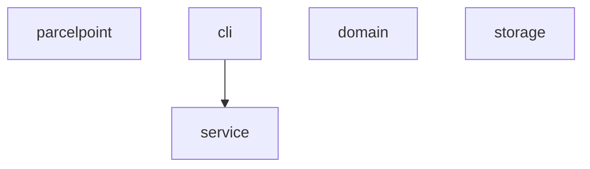
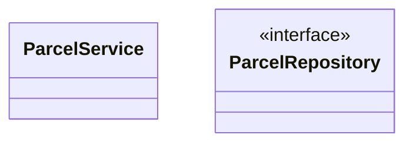
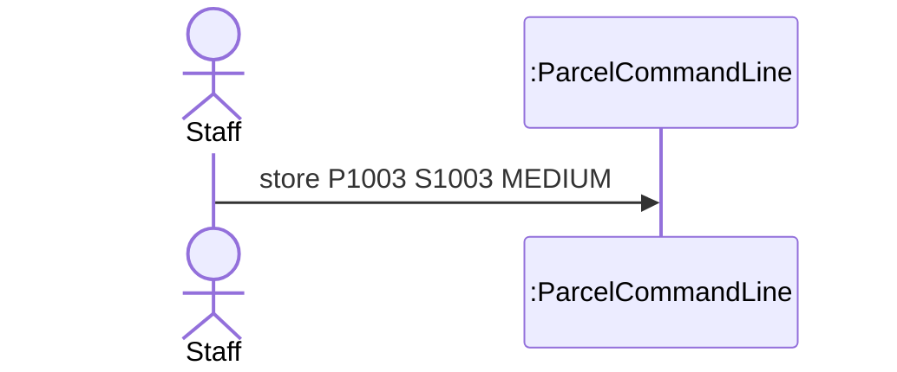

# Lab Report, Designing the Data Management Layer with H2

Repository URL:

## Tools

| Item | Version or name |
| --- | --- |
| JDK | |
| Maven | |
| IDE | |
| AI tool and exact model, if you used one | |

## Part 0. From a store in memory to H2

Commit of the starter, before any change:

0.3 Your prediction for `staff`, written before the second run: Both parcels will disappear after restarting the program because they were stored only in memory.

Output of the second run, for `staff` and `quit`:

```text
> staff
Free lockers: 3
> quit
```

State in one sentence where you think the parcels of the first run were kept.
The parcels were stored in the memory of the running program. When the program ended, the memory was freed and the parcels were lost.

0.5 The line of Main that you would change to keep the parcels somewhere else:

```java
ParcelRepository repository = new InMemoryParcelRepository();

```

0.6 Commit of the switch to H2:

0.7 Output of `SELECT * FROM PARCEL;` after you stored two parcels:
sql> SELECT * FROM PARCEL;
CODE  | STUDENT_ID | PARCEL_SIZE | STATUS | LOCKER_NUMBER
P1001 | S1001      | SMALL       | STORED | 1
P1002 | S1002      | LARGE       | STORED | 3
(2 rows)

```text
SHOW COLUMNS FROM PARCEL;
FIELD         | TYPE                  | NULL | KEY | DEFAULT
CODE          | CHARACTER VARYING(20) | NO   | PRI | NULL
STUDENT_ID    | CHARACTER VARYING(20) | NO   |     | NULL
PARCEL_SIZE   | CHARACTER VARYING(10) | NO   |     | NULL
STATUS        | CHARACTER VARYING(10) | NO   |     | NULL
LOCKER_NUMBER | INTEGER               | YES  |     | NULL
(5 rows)
```

0.8 Explain why ParcelPoint could not start while the H2 Shell was open, and identify the class that wrote the message `Cannot create the PARCEL table`.
The H2 database was already locked by the H2 Shell, so the second application could not open the same database file. This happens because H2 is running in embedded mode. The class that wrote the message "Cannot create the PARCEL table" is `H2ParcelRepository`.

0.9 Explain why `staff` shows no parcel while `find` shows each one, and why all three lockers look free.
The `find` command retrieves parcels from the H2 database, so it can find both stored parcels. The `staff` command shows three free lockers because the staff overview does not read the stored parcel information from the H2 database. This means the staff overview and the database are not synchronized. 

0.11 Your findAll method:

```java

```

Commit that adds findAll:

0.12 Output of `SELECT * FROM PARCEL;` after the pickup:

```text

```

0.13 Optional. Describe what `find P9999'OR'1'='1` showed while the SQL was joined from strings, and what it showed after you put the placeholder back.

## Part A. Model the design

A1 Complete the flowchart with one node for each package and one arrow for each dependency, from the package that uses to the package that is used. Mark the package that accesses the data store.



State whether cli depends on storage, and explain why.

A2 Complete the class diagram of the data management layer with ParcelService, the interface ParcelRepository with its three operations, and the two classes that implement it.



A3 Draw a sequence diagram for the command `store P1003 S1003 MEDIUM`, from the staff member to the repository. Show each message as an operation of the class that receives it.



Explain why the last lifeline is the interface ParcelRepository rather than H2ParcelRepository.

## Part B. Design questions

1. Identify the files that you changed to move from the store in memory to H2, and explain why no other class had to change. Use the terms of this course.

2. The PARCEL table stores the size of a parcel as SMALL, MEDIUM or LARGE rather than as 1, 2 or 3. Identify the type of connascence between ParcelSize and the table in each case, and explain which one is weaker.

3. Project Phase 2 asks for a data store that needs no separate server. Explain why an embedded database such as H2 meets this rule, and describe the limit of an embedded database that Step 0.8 showed.

4. State the data store that you would choose for your Project Phase 2 team, files or an embedded database, the requirement that drives the choice, and the package that will access it.

## AI usage declaration

| AI tool and exact model | Date | Purpose | Files or answers it produced or changed | How you checked its output |
| --- | --- | --- | --- | --- |
| | | | | |
